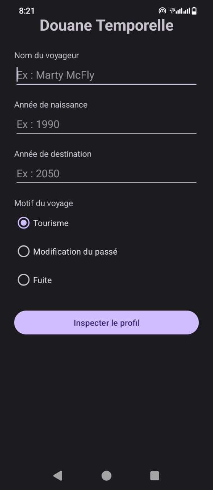
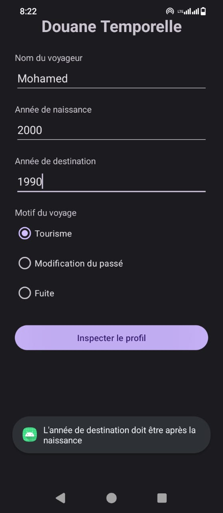
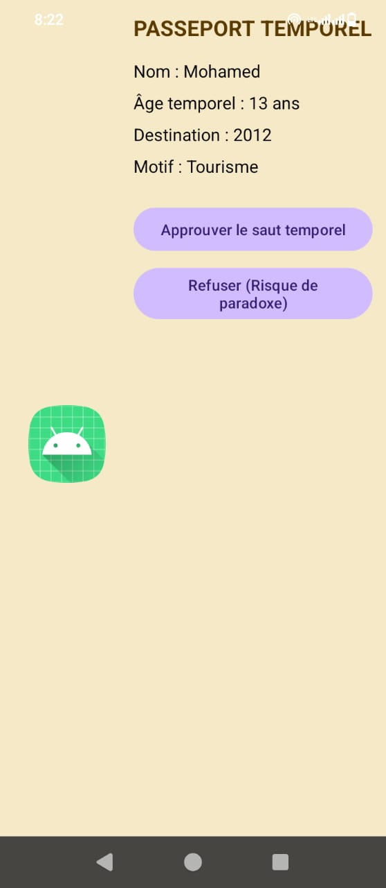
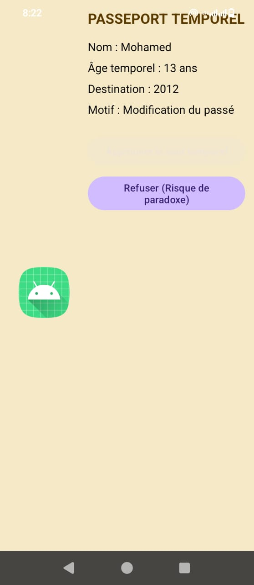

# Douane Temporelle

## Membre du groupe
- Moataz Ridene (3ème BI, Groupe 2) : travail individuel

## Description
Mini-projet Android (DS 1) : poste de douane pour voyageurs du temps.

## Fonctionnement
- Activité 1 : formulaire d'enregistrement du voyageur.
- Activité 2 : passeport temporel avec décision (approuver ou refuser).
- Activité 3 : verdict avec fond vert ou rouge.

## Règle spéciale
Si le motif est "Modification du passé" et que la différence entre l'année de destination et l'année de naissance est un nombre premier, le bouton Approuver est désactivé.

## Captures d'écran

